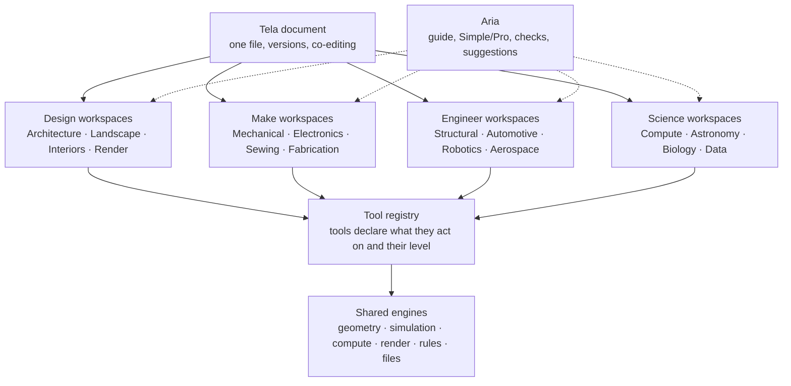

# Tela as one workspace for design, engineering and science

Owner direction, 2026-11-09. This plan extends `docs/CAD_BIM_ENGINEERING_SUITE_PLAN.md` (which covers the engines and licences for each discipline) with the part that plan left open: **how all of it lives in one place, and how a beginner grows into professional work without ever changing tools.**

## The goal in one paragraph

Today, architecture lives in AutoCAD and Revit, landscape in Vectorworks, mechanical in SolidWorks, automotive and aerospace in CATIA and Simulink, robotics in ROS tools, astronomy in Stellarium and PixInsight, and maths in MATLAB. Each has its own file format, licence, price and learning curve, and a person who starts in one is stuck there. **Plajah's answer is Tela as the single workspace.** Every discipline is a workspace inside Tela, using the same documents, the same saving and sharing, and the same guide (Aria). A ten-year-old designing a treehouse and an engineer checking a beam are in the same tool. The difference is only which tools have shown up, because **tools present themselves when the work needs them.**

## 1. Principles

1. **One document model.** A Tela document already holds frames, devices and stable-ID operations, with autosave, versions and live co-editing. Every discipline adds new *device kinds*, never a new file format. DWG, IFC, STEP, URDF, FITS and the rest are import and export doors.
2. **Workspaces, not apps.** A workspace is a lens on a Tela document: a layout, a set of tools, and a guide. Switching workspace never means switching files. A house can have its plan, landscape, structure, render and cost in one document.
3. **Tools appear as they're needed (progressive disclosure).** Each tool declares what it works on and how advanced it is. The shell shows starter tools first and brings in more when the work calls for them: draw a closed wall loop and room tools appear; select a beam and the structural check appears.
4. **Aria guides every workspace.** The CAD room's build guide is the pattern:
   - steps read from the work itself, never ticked by hand;
   - Simple and Pro voices;
   - a "why" for every step;
   - real code and standards citations.
   
   Aria offers to take people further ("you're ready for dimensions") but never forces it.
5. **Safety first, never paywalled.** Hazards cite their rule, and critical ones stop the export. Design aids say what they are not (not a permit, not an engineer's stamp).
6. **Honest about what's real.** Anything estimated, from a photo or from AI, is labelled as an estimate until someone measures it.
7. **Free base, Plajah+ for advanced.** Every workspace is usable free with an account. Heavy compute, pro export packs and advanced solvers sit in Plajah+ ($14.99 and up; the split is still to be decided).
8. **Licence rules from the suite plan still hold.** MIT, BSD and Apache code can be linked anywhere. GPL and AGPL tools run only as separate processes.

## 2. The shape

**Workspace.** A named layout over the document: which panes show, which device kinds are in focus, which guide paths are offered. Examples:
- "Architecture" focuses on `DRAFT_2D`, `BIM_MODEL` and `DRAWING_VIEW`.
- "Robotics" focuses on `MODEL_ASSEMBLY` with joints, a `SIM_STUDY` and a `CALC` cell running the controller.

**Tool registry** (new: `services/workspace/tools.ts`). Every tool registers:
- `acts on`: device kinds and entity types;
- `level`: starter, core or pro;
- `appears when`: a predicate over the document and the selection;
- `teach`: its Simple and Pro text, and its keyboard alias.

The shell builds the tool rail from this registry. Starters always show. Core tools appear when their predicate fires. Pro tools appear in Pro mode, or once someone has used the core tool a few times. Aria uses the same registry to suggest the next tool.

**Skill profile** (per person, per workspace). This records which tools someone has used and which guide paths they've finished. It's stored with their account, so a student who finishes the STEM floor-plan unit opens Architecture with those tools already showing. It never locks anything: Pro always shows everything.

**Guide paths** (generalised from `services/cad/guide/journey.ts`). A path is a set of steps, each with `what`, `why`, `how`, words, actions, and an `evaluate(document)` that reads progress from the work. "Design a home" is the first path. Others follow the same contract: "Plan a garden", "Build a line-following robot", "Launch a model rocket", "Photograph the Moon", "Fit a curve to data".

## 3. What already exists, and where it fits

| Built | Today | Becomes |
|---|---|---|
| CAD & BIM room: drafting with AutoCAD aliases, walls, rooms, library, schedules, ADA and home checks, 3D, IFC | `components/cad`, `services/cad` | Architecture workspace |
| Aria build guide: 10 steps, Simple/Pro, IRC pre-checks | `services/cad/guide`, `components/cad/guide` | The guide-path framework for every workspace |
| Mechanical parts, Make tab (3D print, CNC, sheet metal), machine bridge | `services/mech`, `services/fab`, WinUI bridge | Mechanical and Fabrication workspaces |
| Electronics Lab, describe-it, PCB routing, DRC, parts sourcing | `services/elec` | Electronics workspace |
| Sewing & Plush, 3D fit, grading, print-on-demand | `services/soft` | Sewing workspace |
| STEM Track (31 units, 128 lessons, 19 projects) | build/stem | Guide paths for schools, inside the same workspaces |
| Argilla 3D, Tela 3D runtime (image → GLB) | `services/argilla`, tela3d | Concept massing, and photo-to-plan (section 5) |
| Terra city layer and search, Data Commons (federal data) | `services/terra`, `services/dataCommons` | Site data for Architecture and Landscape |
| Museion Labs (`LabsNotebook`, `LabsFormulaEditor`, `LabsDataVisualizer`) | `components/Labs*.tsx` | Front end for the Compute workspace |
| Aria crew (one face, chartered workers behind her) | `services/crew` | Live "Ask Aria" in every guide path |
| Co-editing, cloud autosave, versions | `services/coedit`, creative cloud | Shared by every workspace for free |

**Step 1 started (2026-11-09):** the shell (`components/workspace/WorkspaceShell.tsx`), tool registry (`services/workspace/tools.ts`), skill profile (`skillProfile.ts`, `profileStore.ts`, synced at `/api/build/workspace/profile`), guide-path contract (`guidePath.ts`) and workspace catalog (`workspaces.ts`). Architecture's drafting rail comes from the registry (`services/cad/workspaceTools.ts`); the Build hub opens rooms in the shell; `npm run test:workspace`; lab: cad-lab `?shell=1`. Tela documents now open CAD, Electronics, Sewing and Biology in the shell (2026-11-10): `TelaView` passes each room's send-to-document hooks and opened file through `roomProps`, and the back button names the document (lab: cad-lab `?shell=1&tela=1`). Electronics joined the registry (2026-11-10, `services/elec/workspaceTools.ts`): an empty sheet shows Select, Wire, Rotate, Delete, Undo, Simulate, Checks and Safety (Safety and Checks are always starters); Part, Over time, Scope, Parts list and Board join as the circuit calls for them, SPICE is earned by simulating. Rooms share `components/workspace/useToolRail.tsx` (the rail hook, Aria's hint card, the fresh dot). Sewing joined too (`services/soft/workspaceTools.ts`): a pattern opens with pieces, Make, Steps, Materials and Safety; Fabric layout and 3D fit join once you set your own measurements, Nest sizes and the tech pack when you plan to sell, machine cutting is earned by making. Biology joined (`services/bio/workspaceTools.ts`): molecules open as a cartoon; atom views join for small proteins or ones with something bound, chain colours for complexes. Pathways start with rate sliders and smooth runs; starting amounts join once a rate is tuned, stochastic runs only for models that count molecules (SBML amounts), never for concentrations; water and SBML export are earned. `useToolRail` takes tool groups so a room with several panels gets a rail per panel. Build Studio's 3D toolbar joined (`services/build/workspaceTools.ts`): a blank plate shows undo/redo, move, turn, stretch, duplicate, delete and home view; Group arrives with a hole beside a solid or two shapes picked, Align with two picked, Ungroup once there's a group, Drop when a shape floats, Top view on a busy plate; Mirror and the snap grid are earned. CadRoom now uses the shared `useToolRail` too, and each shell tab has its own error boundary, so a room that crashes (for example with WebGL turned off) shows a message and the other tabs keep working. Still to do in step 1: live Ask Aria (and Studio's circuit mode on the rail).

**Not started:**
- the Compute (open-MATLAB) notebook;
- landscape;
- renders;
- photo-to-plan;
- automotive, robotics, aerospace and astronomy.

## 4. Each discipline: the beginner door and the professional depth

### Architecture and construction (AutoCAD-familiar)
- **Beginner:** "Design a home with Aria" (shipped as a path).
- **Pro target:** someone who knows AutoCAD sits down and works without reading a manual.
- **Already there:** the command line with aliases (L, PL, C, REC, TR, EX, O, F, MI, RO, SC, DIM, H), object snaps, ortho, grid, F3/F7/F8/F9, typed coordinates (`@500,0`, `@1000<90`), window and crossing selection, grips, layers and blocks, and DXF/DWG in.
- **Familiarity gaps, in order of how much they'd be missed:**
  1. Layouts (paper space) with viewports at a scale.
  2. Dimension and text styles.
  3. Plot styles (CTB/STB) and plot to PDF at scale.
  4. Block attributes and attribute extraction.
  5. Xrefs.
  6. Properties palette and Match Properties.
  7. Polar tracking and object-snap tracking.
  8. Hatch editing.
  9. Multileaders.
  10. Array (rectangular, polar, path).
  11. Stretch, Join, Explode, Break.
  12. Quick Select.
  13. A DWG write round trip.
  14. A small AutoLISP subset.
  
  Each gap gets the same treatment: the AutoCAD alias works, and the Simple-mode label explains it.
- **Construction:** schedules, quantity takeoff, and 4D (model plus timeline), as in the suite plan's phase 2.

### Landscape architecture
- **Beginner:** "Plan a garden or yard": draw the lot, mark the sun and shade, choose plants that grow in your zone, and paths and beds.
- **Pro:**
  - site plans with contours and spot grades, cut and fill;
  - planting plans with plant schedules;
  - hardscape;
  - irrigation zones;
  - tree protection;
  - stormwater (rain gardens, permeable paving).
- **Data:**
  - USDA PLANTS database and USDA hardiness zones (US government, public domain);
  - elevation from USGS 3DEP (public domain);
  - parcels and footprints from city open data where published.
- **Shared with Architecture:** the same document, site layer and library (plant symbols join the existing trees and shrubs).
- **Safety:** call before you dig (811), toxic-plant flags for homes with children and pets, and slope and retaining-wall heights that need an engineer.

### Renders from drawings
- **Path:** the plan's BIM model (already in 3D) → materials and lights → a render.
- **Engines:**
  - in the browser, a path tracer on WebGL (three-gpu-pathtracer, MIT);
  - on the desktop, the native GPU engine first (the desktop-first AI rule);
  - an optional AI restyle conditioned on the model's depth and edges, so the building's geometry stays true.
- **Beginner:** "Make it look real": pick a time of day and a style.
- **Pro:** cameras, exposure, materials, HDRI lighting, sun study by date and location, turntables, and a walkthrough video into Fabula.
- **Honesty:** AI-restyled renders are labelled as concept images.

### Photo or concept image → plans (new)
Two different jobs. The plan treats them differently because one is imagination and the other is measurement.

1. **Concept image → design.**
   - A generated or sketched picture of a house becomes a 3D massing (the Tela 3D image-to-3D runtime).
   - The massing becomes a footprint and an editable wall shell in the plan.
   - Aria then walks the guide path from the "rooms" step.
   - The result is clearly labelled a *concept*. Nothing in it is a measurement.
2. **Real photos → existing building (as-built).**
   - **Exterior photos:** facade elevations rectified from one or more photos, with the person giving one known dimension (a door is about 2 m) to set the scale.
   - **Interior:** a phone room scan gives walls, doors and windows directly.
     - iPhone/iPad LiDAR via Apple RoomPlan exports walls and openings.
     - Without LiDAR, a photo set goes through photogrammetry on the desktop engine.
     - Either way, the scan becomes Plajah walls and openings.
   - Every photo-derived dimension shows its uncertainty, and the guide asks for a tape-measure check of key dimensions before drawings go out.
3. **Site photo → site.**
   - Put the photo on the Terra map.
   - Pull the parcel outline, and the building footprint where published.
   - Draw setbacks.
   - Start the shell inside them (the guide's "Your land" step, fed with real data instead of typed numbers).

### Pulling public plans for an address (Detroit, and in general)
**What's public in Detroit today:**
- **Building permits** issued by BSEED (2019 onward) and **plan-review records** are datasets on the city's open data portal ([detroitdata.org building permits](https://detroitdata.org/dataset/building-permits), [plan reviews](https://detroitdata.org/dataset/building-permit-plan-reviews)).
- **Parcels:** the Assessor's dataset is updated daily.
- These records say *what* was permitted and when, not the drawings.

**The plan sheets themselves:**
- They aren't on the portal. They come from BSEED through a FOIA request ([City of Detroit FOIA](https://detroitmi.gov/taxonomy/term/1211)).
- Michigan FOIA §13(1)(y) lets a public body withhold building designs that relate to its ongoing security measures, unless the public interest outweighs the harm.
- Requesters can ask for the non-exempt parts with the exempt parts redacted ([House bill analysis](https://legislature.mi.gov/documents/2001-2002/billanalysis/House/pdf/2001-HLA-5349-A.pdf), [MCL 15.244](https://renderpdf.legislature.mi.gov/documents/mcl/pdf/MCL-15-244.pdf)).
- Expect it to be slow, partial and fee-based, and to vary by building.

**Copyright:**
- Architectural plans and buildings are protected works under US copyright law (17 U.S.C. §102(a)(8)). A FOIA copy lets someone *see* the plans; it doesn't give them the right to reuse or sell a design based on them.
- Photographing a building visible from a public place is expressly allowed (17 U.S.C. §120(a)). So photo-to-plan for your *own* project, or as-built documentation of a building you own, is on solid ground.

**What we build:**
- **"What's public about this address"** pulls everything open automatically: parcel, footprint, zoning where published, permit history, plan-review history.
- **"Request the plans"** helps the owner write and track a FOIA request to the right office. The person sends it themselves.
- **"I have my plans"** uploads the owner's own plan set (PDF or DWG) and traces it into an editable plan.
- We don't scrape or redistribute other people's plan sets.
- **Starting point:** Detroit, because the open data is good. The data source is an adapter per city, using the Data Commons pattern, so other cities slot in.
- **Needs legal review before launch:** the FOIA helper and the copyright wording.

### Mechanical and automotive
- **Beginner:** "Design a soapbox car" or "a go-kart frame": tubes and joints, weight and balance, brake and steering safety.
- **Pro:**
  - sketch constraints, feature tree and assemblies (suite plan, phase 3);
  - suspension kinematics;
  - multibody vehicle dynamics (MuJoCo, Apache-2.0; Project Chrono, BSD-3);
  - systems modelling with Modelica (OpenModelica is OSMC-PL/GPL, so it runs as a separate process);
  - EV battery packs (cell layout, thermal, BMS on the Electronics workspace).
- **Already there:** vehicle templates (from the wrap designer) and machining.
- **Safety:** Federal Motor Vehicle Safety Standards (49 CFR 571, public domain) cited for anything road-going. Go-kart and soapbox paths flag helmets, brakes, roll-over and speed.

### Robotics
- **Beginner:** "Build a line-following robot" with the Electronics Lab (already there) plus a chassis from Mechanical and a few lines of code.
- **Pro:**
  - URDF import and export;
  - ROS 2 (Apache-2.0) through a bridge from the desktop app (rosbridge-style), plus a link to the existing machine bridge (USB serial);
  - arm kinematics (forward and inverse), path planning;
  - simulation in MuJoCo before anything moves for real.
- **Tie-ins to robotics platforms:** ROS 2, Arduino and ESP32 (already in Electronics), Raspberry Pi, and the open robot description formats (URDF, SDF, MJCF). Each is an adapter, not a rewrite.
- **Safety:** pinch points, moving-arm envelopes, an emergency stop required in the design (ISO 10218 cited by number only; its text is copyrighted), and battery fire safety.

### Aerospace
- **Beginner:** "Launch a model rocket": stability (centre of pressure behind centre of gravity), motor choice, recovery.
- **Pro:**
  - aircraft concept design (OpenVSP is under the NASA Open Source Agreement; confirm before linking);
  - flight dynamics;
  - drones (PX4 is BSD-3 and can be linked; ArduPilot is GPL-3, so it runs as a separate process);
  - orbital mechanics with Orekit (Apache-2.0) or our own solver;
  - trajectory and ascent simulation.
- **Rocket simulation:** our own engine. OpenRocket is GPL-3, so it can only be an optional separate tool.
- **Safety:**
  - NAR/Tripoli model rocket safety codes;
  - FAA 14 CFR Part 101 for rockets and Part 107 for drones (public domain);
  - waivers and airspace flagged before any launch plan is exported.

### Astronomy
- **Beginner:** "Photograph the Moon" or "Find Saturn tonight": a live sky for your location and time, and what your telescope or phone can see.
- **Pro:**
  - ephemerides from NASA JPL Horizons;
  - catalogues (Gaia DR3 under ESA terms, HYG; check each licence);
  - telescope control through INDI (LGPL, as a separate process on the desktop) and ASCOM on Windows;
  - astrophotography stacking in the Tela image pipeline;
  - data from MAST and other public archives;
  - FITS in and out.
- **Sky view:** our own WebGL. Stellarium is GPL, so it is optional and runs separately.
- **Safety:** solar observing (never without a certified filter) gates any Sun target.

### Compute: the open-MATLAB workflow
- **Status:** planned, not started (no Pyodide code in the repo yet).
- **Pieces:**
  - **`CALC` device:** notebook cells inside any Tela document. Python through Pyodide (NumPy, SciPy, SymPy; BSD) in the browser, and native Python or Julia on the desktop.
  - **Bound to model parameters:** change a beam size in the plan and the calc reruns, and vice versa.
  - **Plots:** the existing TelaChart.
  - **Museion Labs** is its showcase: a gallery of runnable studies.
- **Beginner:** "Fit a line to my data" or "How fast does my rocket go?"
- **Pro:** matrices, ODEs, optimisation, signal processing, control (python-control, BSD), and units-aware maths.
- **MATLAB's language:** we don't clone it. A `.m` reader for simple scripts can come later.
- **Simulink:** Modelica (above) is the systems-modelling answer.

### Electronics, Sewing & Plush, Fabrication, STEM
All built. They move into the shell as workspaces with their guide paths.

## 5. Shared engines, built once

| Engine | Used by | State |
|---|---|---|
| Geometry: 2D entities, walls, B-rep (OCCT WASM), meshes | Architecture, Landscape, Mechanical, Automotive, Robotics, Aerospace | 2D and walls built. OCCT import built. Modelling not started. |
| Simulation: frames, FEA (CalculiX), multibody (MuJoCo/Chrono), circuits (ngspice), cloth (own) | Structural, Automotive, Robotics, Aerospace, Electronics, Sewing | Cloth and circuit sim built, others planned |
| Compute (`CALC`) | Everything | Not started |
| Render: viewport, path tracer, AI restyle | Architecture, Landscape, Mechanical, Product | Viewport built |
| Rules and safety: rule packs that cite their sources, export gates | Everything | Built for ADA, IRC (new), OSHA, CPSC, toys, machines and radios |
| Files: import/export doors (DWG, DXF, IFC, STEP, STL, 3MF, Gerber, URDF, FITS) | Everything | Most 3D and 2D in place. URDF and FITS not started. |
| Data adapters: city open data, USDA, USGS, NASA, JPL | Landscape, Architecture, Aerospace, Astronomy | Data Commons pattern exists |
| Aria: guide paths, Ask Aria, suggestions | Everything | Guide framework built in CAD |

## 6. One person's path, start to finish

A 10-year-old opens Tela for a school project:
- **"Design a treehouse" (STEM Track):** Simple mode, Aria explains every step, the safety check flags the railing height.
- **A year later**, a "Robot that waters the plants" in Electronics. The same document style, the same Aria, and the Make tab prints the brackets.
- **In high school**, Pro mode in Architecture for a real shed: dimensions, layouts and a permit-ready set.
- **In college**, the beam check in the shed's own calc cell, and a render for a portfolio.

The tools were all there from the first day. They showed up as each project needed them.

## 7. Order of work

| # | Piece | Why now | Rough size |
|---|---|---|---|
| 1 | **Workspace shell, tool registry, skill profile, guide-path framework** (generalise the CAD guide) | Everything else plugs into it | 4-6 weeks |
| 2 | **AutoCAD familiarity pass**: layouts and viewports, dimension and text styles, plot to PDF at scale, block attributes, properties palette, polar tracking, array, stretch/join/explode/break, multileaders | Biggest need from working professionals; builds on what exists | 6-8 weeks |
| 3 | **Site from address**: Terra plus parcel, footprint and permit history (Detroit first), the "Your land" step fed with real data | Small, uses existing data patterns, makes the guide feel real | 2-3 weeks |
| 4 | **Landscape workspace**: planting with the USDA database, grading, a "Plan a garden" path | Shares the document and library with Architecture | 6 weeks |
| 5 | **Renders**: path tracer from the BIM model, sun study, AI restyle on the desktop engine | High wow, low risk | 4 weeks |
| 6 | **Compute (`CALC`) in the browser** through Pyodide, bound to model parameters | Unlocks engineering and science everywhere | 6 weeks |
| 7 | **Photo-to-plan**: concept image → massing → shell; room scan → walls and openings; facade rectify | Builds on 3, 5 and the Tela 3D runtime | 6-8 weeks |
| 8 | **Automotive and robotics** foundations: assemblies with joints, URDF, MuJoCo, ROS 2 bridge, soapbox and robot paths | Needs the shell and compute | 8-10 weeks |
| 9 | **Aerospace and astronomy** starters: rocket path, sky view, Horizons ephemerides | Needs compute and render | 6-8 weeks |

Steps 2-3, 4-5 and 6 can run in parallel sessions once step 1 lands, because they touch different files. Each ends with a gate checked in its lab, the way the Build work does.

## 8. Decisions for Kenne

1. **Workspace naming in the app:** keep each under Tela ("Tela · Architecture") or give them product names (as Chora and Fabula have)? Recommendation: keep them under Tela. The point is that it's one place.
2. **Skill profile:** tools appear automatically as people grow (recommended), or only when Aria suggests them and the person says yes?
3. **Plajah+ line:** suggested free/paid split:
   - **Free:** every guide path, all drafting, all safety checks, browser compute, and preview renders.
   - **Plajah+:** high-resolution and AI renders, cloud simulation time, pro export packs (DWG write, plot sets), and team workspaces.
4. **FOIA helper and photo-to-plan:** get legal review before launch (copyright wording, and making sure people only trace plans they own or are allowed to use).
5. **Order:** confirm the sequence in section 7, or move automotive and robotics earlier.

## What this plan doesn't claim

- No literal copy of AutoCAD, Revit, CATIA or MATLAB. The aim is familiarity and everyday coverage, as set out in the suite plan.
- Nothing produced is a permit, an engineer's stamp, a survey or a flight approval. Each workspace says so where it matters.
- The time estimates assume the same way of working as the Build work (engine plus tests plus lab gate). They aren't commitments.
