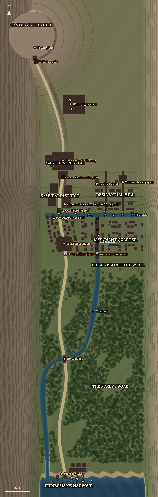

# Era Clash 3D: map of Otsu-no-ura

Generated from the running game (`eraclash3d.mapDoc()` on the dev server) on 2026-11-12. Don't edit by hand: add places to `cityPlaces()` in `games/era-clash-3d/src/places.ts` and re-export.

North (+Z, up the valley) is at the top. As in the game view from above, +X is to the left. Coordinates are metres; sea level is y = 0.

## Districts

| Place | x | z | Stills | What is there |
|---|---|---|---|---|
| Fisherman's Harbour | -12 | -498 | 6, 7, 9, 15, 29 | The beach landing, three piers with moored boats, fish racks. The chapter starts here. |
| The Forest Road | -95 | -300 |  | A quarter mile of dense mixed forest between the harbour and the Outer Wall, the road through it, the river across it. |
| Fields before the wall | -110 | -58 |  | Open ground between the forest and the Outer Wall. |
| Merchant Quarter | -105 | -8 | 3, 5, 12, 17 | Shop streets and the Maze of Alleyways west of the road, between the Outer Wall and the canal. |
| Residential Hill | -105 | 82 | 21, 24, 27 | Five stone-walled terraces with stepped lanes, board fences and small houses. |
| Samurai District | 5 | 80 | 1, 23 | Four walled compounds either side of the avenue, behind the Samurai District gate. |
| Castle approach | -5 | 145 | 8, 18, 19, 26, 31 | The main gate, the masugata and the forecourt below the castle hill. |
| Castle on the hill | 62 | 420 | 4, 10, 14 | Lord Kageyama's keep (proposed name) on its walled hilltop, 46 m up: the gate, the yard, the empty keep. |

## Landmarks

| Place | x | z | Stills | What is there |
|---|---|---|---|---|
| Beach landing | 2 | -474 | 15, 29 | Where Haru's warband comes ashore. |
| Grand Marketplace | -3 | -16 | 25 | The square on the road: stalls, the broker, the first fight inside the wall. |
| Watchtower and bell | 12 | 36 | 14 | The alarm bell where the road meets the canal. |
| Sōbei's shop (proposed) | 17 | 34 | 12 | The broker's raided shop: The Broker's Strongbox. |
| Magistrate Kuroda's compound (proposed) | -4 | 63 |  | Where the seal for the castle gate is given. |
| Hill temple and pagoda | -120 | 106 | 4, 10 | Hall, bell house and five-storey pagoda on the crown of the hill. The children shelter here. |
| Rooftop lookout | -68 | 103 | 20 | A yagura over the roofs (deck 6 m up). Fire from the Roofs is fought here. |
| Oyone's house (proposed) | -83 | 48 | 27 | The mother of the hidden children, at the foot of the hill lanes. |
| Forecourt under the keep | -1 | 150 | 19 | The last fight. |
| Pier 1 | -40 | -490 | 16, 28 | A burning boat to douse (The Burning Boats). |
| Pier 2 | -29 | -485 | 16, 28 | A burning boat to douse (The Burning Boats). |
| Pier 3 | -18 | -482 | 16, 28 | A burning boat to douse (The Burning Boats). |
| River bridge | -4 | -245 |  | The road crosses the river halfway through the forest on a timber bridge. |
| The keep door | 55 | 374 |  | The keep stands empty; the search here starts the end of Act I. |
| Hōrin-ji (proposed) | -16 | 262 |  | Temple on a terrace by the castle road: main hall, bell house, stable. Abbot Ennen and Sōta (proposed). |
| Bell house | -15 | 270 |  | Where Sōta is bound. |
| Temple stable | -18 | 252 | 23 | The horses for the ride to the mountain (Act II). |

## Gates and walls

| Place | x | z | Stills | What is there |
|---|---|---|---|---|
| Outer Wall gatehouse | -6 | -36 | 14 | The town gate on the forest road (z −36). |
| Water gate (mizumon) | -69 | -36 |  | The channel passes under the Outer Wall: a raft or a swim into town that skips the gatehouse. |
| Samurai District gate | 7 | 50 |  | Gate across the avenue at z 50. |
| Castle hill gate | 53 | 347 |  | A yagura gate where the ridge road reaches the hilltop walls. |
| Ōtemon (main castle gate) | -1 | 116 | 18, 26, 31 | Barred until the magistrate's seal is shown. |

## Waterways

| Place | x | z | Stills | What is there |
|---|---|---|---|---|
| The canal | -140 | 42 | 2 | Stone banks and arched bridges along z 42, about 1.35 m deep: swim or raft. |
| The channel | -69 | -12 |  | South from the canal between the merchant streets to the water gate, where it becomes the river. |
| The river | -62 | -150 |  | From the water gate it winds south through the forest to the sea: swim it, or raft from the canal to the sea. |
| Canal bridge 1 | 6 | 42 |  | Arched bridge over the canal. |
| Canal bridge 2 | -52 | 42 |  | Arched bridge over the canal. |
| Canal bridge 3 | -86 | 42 |  | Arched bridge over the canal. |
| Canal bridge 4 | -120 | 42 |  | Arched bridge over the canal. |
| Channel bridge 1 | -69 | -12 |  | Arched plank bridge over the channel. |
| Channel bridge 2 | -69 | 12 |  | Arched plank bridge over the channel. |
| Channel bridge 3 | -69 | 34 |  | Arched plank bridge over the channel. |

## Landings and rafts

| Place | x | z | Stills | What is there |
|---|---|---|---|---|
| Canal landing 1 | -138 | 45 |  | Steps down to a stone stage: climb out here. |
| Canal landing 2 | -103 | 39 |  | Steps down to a stone stage: climb out here. |
| Canal landing 3 | -58 | 39 |  | Steps down to a stone stage: climb out here. |
| Canal landing 4 | -26 | 45 |  | Steps down to a stone stage: climb out here. |
| Canal landing 5 | 19 | 39 |  | Steps down to a stone stage: climb out here. |
| Channel landing 1 | -66 | -24 |  | Steps down to a stone stage: climb out here. |
| Channel landing 2 | -72 | 1 |  | Steps down to a stone stage: climb out here. |
| Channel landing 3 | -66 | 26 |  | Steps down to a stone stage: climb out here. |
| Raft 1 (start) | -101 | 40 |  | Tied up at a canal landing. |
| Raft 2 (start) | -70 | 2 |  | Tied up at a channel landing. |
| Raft 3 (start) | -58 | -488 |  | Drawn up in the sea west of the harbour. |

## Quests

| Quest | Where |
|---|---|
| ◆ Smoke Over Otsu-no-ura | Beach landing → Outer Wall gatehouse → Grand Marketplace → Magistrate Kuroda's compound (proposed) → Ōtemon (main castle gate) → Forecourt under the keep → Castle hill gate → The keep door → Hōrin-ji (proposed) → Bell house → Temple stable |
| ◇ The Held | across the town (no single place) |
| ◇ The Burning Boats | Pier 3 |
| ◇ The Broker's Strongbox | Grand Marketplace → Sōbei's shop (proposed) |
| ◇ The Hidden Children | Oyone's house (proposed) → Hill temple and pagoda |
| ◇ Fire from the Roofs | Rooftop lookout |

## Planned, not built yet

- West shore: the sea-wall promenade with its lanterns, the long piers and the waterfront street (stills 11, 16, 28, 30).
- The castle keep on its moated stone base, the ramparts over the harbour (still 8).
- Shop interiors you can step into in the merchant streets.
- Canal boats moving on the water; the Petals on the Water escort.
- The forest road: the open fish market on the new quay, watchtowers, hidden camps, the bridge rescue, the shrine of Michael, wildlife (docs/era-clash-3d-forest-road.md).
- Horses at the temple stable (they wait now; riding comes with the horse rig).
- Act II (its own area): the valley ride, the mine and Gōzan (proposed), the ascent, the crystal cave, the lava caverns, the crater oasis and Kurenai the Ash Witch (proposed).
