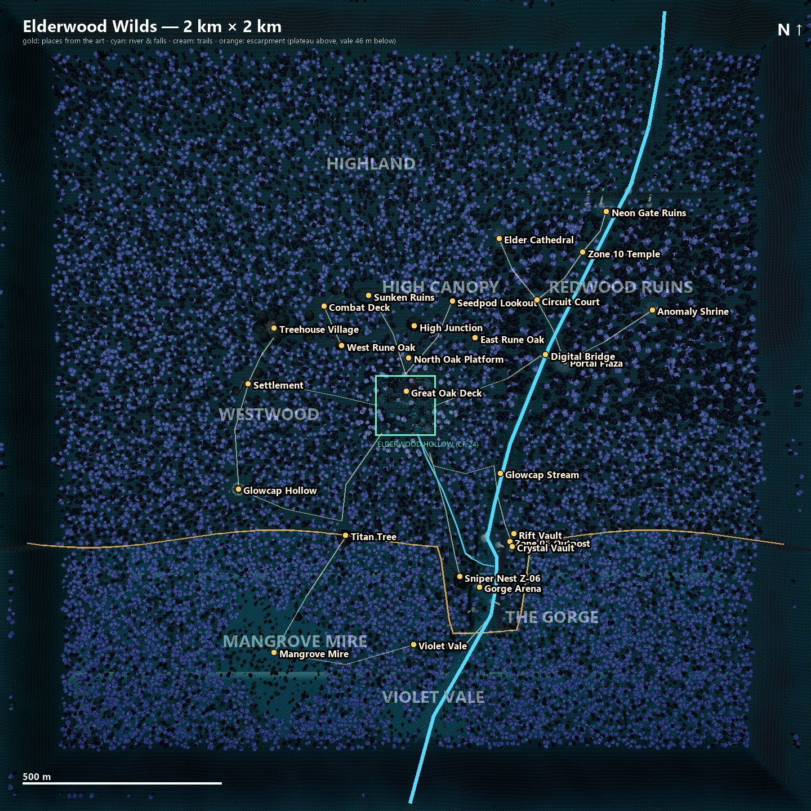

# Rift Realm — open-world scale-up (Kenne, 2026-11-21)

Kenne's direction: levels are far too small. Each level should be PUBG / COD / Fortnite big, quasi open world
with hints of Skyrim scale. The mix: Call of Duty gunplay + Mortal Kombat fighting (gun-fu, close quarters,
finishers) + Hunger Games / Maze Runner arenas and trials. Every level is a living ecosystem of its own.
First up is the forest level, expanded from the art, with richer, more detailed trees, fauna and vegetation.

Today Elderwood Hollow is a 152 m square (BOUND 76). That's a COD 6v6 map, not a world.

## Tracks

| # | Track | Owner | Depends on |
|---|-------|-------|------------|
| 1 | **Elderwood Wilds**: forest open world, ecosystem, terrain + streaming | this session | — |
| 2 | **Characters from video**: motion clips derived from each character's videos, high-quality build + rig from the sheets | own session | — |
| 3 | **Combat**: weapons, fight moves, gun-fu, close quarters, combat AI | own session | uses track 2 clips when they land |

Tracks 2 and 3 touch different files from track 1 (characters/mocap/rig vs player/enemies/weapons vs world/terrain/
vegetation), so they run in parallel. Whatever a track needs from another goes through a small interface:
- the world gives AI `nav` (groundAt, rayDistance, a coarse walk grid) and spawn/region data;
- characters give combat named clips (see the clip contract in characters.ts) plus attachment sockets for weapons.

## Track 1 — Elderwood Wilds

**Size.** 2 km × 2 km (4 km²) for this first build, between a Fortnite island (~5.5 km²) and a big COD map.
The engine is built so the map can grow to 4 km+ (battle-royale size) without a rewrite. Elderwood Hollow (the
CF-24 arena) stays intact at the centre as the Great Oak hub, and Domination still plays there.

**Regions (from the Cyber Forest + Elderwood art):**
- **Great Oak Hollow** (centre): the existing arena, platforms, rope bridges, cabin, chapel, watchtower.
- **Titan Grove**: ancient titan trees (Ancient_cyber_forest_titan_tree), roots you run along, canopy walkways.
- **Mangrove Mire**: river delta, cybernetic mangroves, aquatic plants, axolotl / amphibians / serpent.
- **Fungal Deep**: neon mushroom forest, spore fields, toadstools, hollow-log tunnels.
- **Crystal Glades**: crystalline plants, the crystal stag and deer herds.
- **Ruin Maze**: CF-23 ruin walls as a Maze Runner labyrinth whose walls shift on the beat, with trials inside.
- **Waterfall Gorge + Watchtower Ridge**: CF-22 waterfall pool at the head of a gorge, high ground for snipers.

**Living ecosystem:** herds graze and flee (deer, stag), predators hunt prey and players (electric wolf packs,
venom mantis), fliers (wasps, bats, moths, dragonflies) work their zones, and small life (beetles, caterpillars,
salamanders, toads) fills the ground. A day/night and aurora cycle drives behaviour: bioluminescence comes up and
predators roam at night.

**Trials (Hunger Games / Maze Runner):** timed runs through the Ruin Maze, supply-cache drops, a closing storm
ring for battle-royale modes, and creature lairs as optional fights.

**Engine work needed (in order):**
1. **Terrain:** a world height function made of regions (river carve, ridges, gorge, maze floor); chunked terrain
   meshes with distance LOD; ground collision from the height function (BVH only for structures).
2. **Streaming:** world cells (64 m); structures, props and colliders load and unload around the player.
3. **Vegetation at scale (Plajah Vegetation service):** spatial grid culling in Forest / PlantField /
   FungusField (only visit nearby cells), impostor forest to the horizon, the grass ground window follows the
   player (re-bakes as you move), new species from the art (titan tree, mangrove, crystal plants, aquatic).
4. **Fauna:** an ecosystem sim (needs, herds, predator-prey, territories, day/night) driving the existing
   creature bodies plus new ones built from the sheets.
5. **Performance budget:** 60 fps high tier, 30 fps on the Arc iGPU low tier; draw distance ~1.2 km with
   impostors and fog into the sky.

### The built map (2026-11-21): every forest shot is a place

Kenne: "everything in the shots for each level needs to be able to be real moments and places in the game; all the forest
and cyber fantasy forest should logically be built into one huge map." Code: `games/rift-realm/src/world/` (layout, terrain,
kit, places, shots, index), hooked into `elderwood.ts`; `?level=elderwood` is now the whole world, `?classic` plays the
152 m arena alone. Paired screenshots (art | game) for every shot: `docs/rift-realm-wilds/<shot>.jpg`, contact sheet
`docs/rift-realm-wilds/index.jpg`. Re-shoot: `node scripts/riftrealm/wilds_shots.mjs` (headed Chrome parked off-screen on
the RTX 4070, since headless Chrome has no WebGPU here) then `python scripts/riftrealm/wilds_pairs.py`; map:
`scripts/riftrealm/wilds_map.py`.

**Logic of the map.** The hollow (CF-24) sits unchanged at the centre of a forested plateau. A river comes off the
Highland in the north-east, falls 26 m at the Neon Falls behind the Neon Gate ruins, runs south past the Redwood Ruins under
the Digital Bridge, cuts the rock ravine of Glowcap Stream, and drops 42 m at the Great Falls into the Gorge, a slot cut
into the escarpment's southern spur, before it spills into the Violet Vale 46 m below the plateau. The Waterfall Pool's
stream (CF-22) runs south and falls into the Gorge's west wall beside the arena. The High Canopy grows north out of the
Great Oak's deck (a new opening in its rail), bridge by bridge, out to the Treehouse Village in the west. The Titan Tree
grows up the escarpment face: its hollow trunk is the way between plateau and vale, with the bunker floors inside.

**Inventory: shot → place** (x, z in metres; x east, z south)

| Place | Where | Shots it reproduces | What is built |
|---|---|---|---|
| Great Oak Deck / hollow | 2, −36 | CF-24 map, eh-02, eh-07, eh-08, eh-09, eh-10 | the existing CF-24 level (elderwood.ts) |
| North Oak Platform → High Junction | 8, −120 → 22, −200 | eh-05 (five bridges, hut round a trunk, 22 m up) | crenellated decks round living trunks, rope bridges, stairs down |
| Canopy network | 8…−205, −120…−286 | eh-01 (aerial of stone-capped decks and bridges) | 12 decks, 14 bridges, the oak-deck bridge |
| West / East Rune Oak | −160, −150 / 175, −170 | eh-03, eh-04 (rune spawn decks) | decks with rune circles (spawns for big modes) |
| Sunken Ruins | −92, −276 | eh-06 (broken bridge over a ruin pit) | 22 m pit, old tower deck mid-span, broken bridge with a jump gap |
| Seedpod Lookout | 118, −262 | eh-11 | small deck, vines hung with glowing pods |
| Combat Deck | −205, −250 | eh-12 | square plank hub on posts, bridges on every side, treehouses |
| Treehouse Village | −330, −195 | Treehouse_village…, elderwood-hollow.webp, image.png 2/4 | 32 m rune plaza in the canopy, seven treehouses on giant oaks |
| Settlement | −395, −55 | Cyber-forest_settlement | stone tower houses with lit windows, treehouses, bridge to a tower top, crystals |
| Glowcap Hollow | −420, 210 | Dark_fantasy_map_forest_arena, mushroom turntable | sunken clearing, gold/cyan circuit rings, giant mushrooms, arches, stairs |
| Titan Tree | −150, 326 | Cyber-forest_bunker_interior, Camera_ascending_tree_ramp (video) | 26 m hollow trunk across the escarpment, spiral ramp vale→plateau→lookout, three bunker rings, green conduits |
| Glowcap Stream | 238, 170 | Stream_rushing_through_bioluminescent… | ravine walls, giant mushrooms on the ledges, old pipe along the bank |
| Zone 05 Outpost | 262, 342 | Waterfall_overlook_outpost_balcony | balcony on the Gorge rim beside the falls, ZONE 05 screens, the cliff spring |
| Sniper Nest Z-06 | 136, 430 | Sniper_nest_in_cyber_forest, Cyber-forest_high_canopy_sniper (video) | 20 m nest in a rim oak, sandbags, Z-06 screens, bridge to the rim deck, scaffold stair down the wall |
| Gorge Arena | 186, 456 | (the sniper shots' target) | raised ring of light between the falls, pylons, stairs |
| Crystal Vault → Rift Vault | 268, 354 → 272, 322 | Underground_vault…, Vault_interior_flythrough (video) | cave behind the cliff spring, crystals, ammo lockers; rune hall, pillars, gold circuit floor, rift portal |
| Mangrove Mire | −330, 620 | Camera_moving_along_mangrove_walkway (video) | boardwalks on stilts, stilt huts, terminals, a walkway through a giant trunk |
| Violet Vale | 20, 600 | the overlook's view | violet forest under the escarpment, standing water |
| Portal Plaza | 400, −110 | Bioluminescent_cyber_forest_spawn | paved plaza, gothic arches, the portal gate, floor circuits, redwoods |
| Circuit Court | 330, −265 | Camera_moving_through_cyber_forest (video) | square court, circuits converging on a stele (rune_monolith.glb) on round steps |
| Elder Cathedral | 235, −420 | Firefight_in_cyber_forest_chapel, Cyber-forest_chapel_ruin_flythrough (video) | roofless nave, arcades, rose window, a tree through the floor |
| Zone 10 Temple | 445, −385 | Bioluminescent_cyber_forest_environment | stepped platform, arch, two statue plinths, ZONE 10 pillar |
| Neon Gate Ruins | 505, −488 | Neon_grid_forest_ruins, Cyberpunk_forest_ruins_with_neon | neon grid floor, holo gates and screens, arches, the Neon Falls and the rim cascades behind |
| Anomaly Shrine | 620, −240 | Cyber_forest_central_shrine_arena, the two compact 3v3 blueprints | sunken octagon, crystal pillar under a light beam, standing stones, scaffold galleries |
| Digital Bridge | 352, −128 | tactical blueprint (Cyber Forest Level Assets) | stone span over the river, cyan rails |

Not places (left out on purpose): the two Fallen Archangel key arts (a character over floating sky ruins), the energy bridge
and orbiting stone court videos (Celestial level), image.png 1/3 (volcanic, floating isles), pickup/shield prop sheets.

**Engine.** World height baked into grids once (2 m over 2 km, 1 m over the hollow; ~1.5 s), 400 terrain chunks streamed
at three detail levels, collision as a height field with caves (vaults, the Titan Tree's hollow) plus a trunk grid for the
20 000 grown trees (collision.ts `TerrainField`, no giant BVH), a pool of 7 point lights handed to the nearest lamps, the
grass ground baked over the whole world. ~20 000 trees, ~19 000 plants, ~4 200 fungi.

**State / not done yet.** Structures are kit geometry plus the existing sheet-built models (rune monolith, mushroom
cluster); no new build-from-sheet models were made this pass (tela-3d not run). Next: sheet builds for the treehouse hut,
the stone tower houses, the statues of Zone 10, the sniper shelter. Art is daylight with god rays, the level is night
(nebula sky): a day cycle would close most of the remaining gap in the pairs. Weak pairs today: the aerial canopy view
(scatter crowns hide the network), the Gorge views (the walls read as grassy slopes from the rim), Glowcap Stream (the river
surface is a flat glowing sheet, no white water). The High Canopy bridges are walkable; enemies still path only inside the
hollow.

### Geometry score against the art (2026-11-22)

`scripts/riftrealm/wilds_depth.py <shot ids>` (run with `D:/Plajah Runtime/tela-py/Scripts/python.exe`) puts the art shot and
the game frame through the same local depth model (Depth Anything V2 Base), aligns them, and scores the layout (share of
pixels within 10 % depth) and the silhouettes (edge F-score); diagnostics in D:/rr_work/wilds/depth, the Portal Plaza one is
`docs/rift-realm-wilds/depth/portal-plaza.jpg`.

**Portal Plaza, first place done this way:** rebuilt from the shot's own camera: columnar redwood trunks framing the edges,
the ruin line 24 m out with the tall pointed arch left and the portal arch right of centre, a deeper stand of trunks behind,
puddles, near-corner wreckage. Silhouettes 0.238 → 0.271; the total score 0.627 → 0.610, so it did not go up. The old
open plaza matched the art's broad near-to-far floor gradient, and what still costs points is not the ruins: the night sky
above them where the art has a hazy daytime stand of trunks and foliage, and the bare flagstones where the art's floor is
full of moss, ferns and roots. Next for every place: score under a daytime haze (as the shots are lit), mask the sky, and
add the floor clutter; the rocks still show the volcanic sheet's orange cracks and need a forest rock material.

**Haze + clutter pass (2026-11-22).** `?time=day` gives the world the art's misty daylight (soft green-grey sky light,
warm sun, dense haze, haze sky) — the level's own look stays the nebula night; `DAY=1 node scripts/riftrealm/wilds_shots.mjs`
shoots under it. The depth score now ignores the game's sky. `kit.clutter()` overgrows a floor (moss patches, heaved
flagstones, roots, ferns, grass back in the cracks); kit rocks use a grey-green mossy rock instead of the volcanic sheet.
Portal Plaza under daylight: 0.600 (layout 0.820, silhouettes 0.271), no gain. What the diagnostic shows: the floor
clutter is too low and too blue-grey to change the depth or the silhouettes; the ferns and bushes along the ruin bases
(Cyber Forest fern/bush species, teal) disappear against hazy paving, and many of their spots fall inside the wall line.
The art's floor reads by green moss mounds and big leafy masses. Next: a green, leafy undergrowth species sized like the
art's (1–3 m mounds), mossy mounds as geometry (not decals), placed only in front of walls.

**Green undergrowth + moss mounds (2026-11-22).** Two green forest species from the shots (`CF_UNDERGROWTH`, `CF_FOREST_FERN`,
catalog indices 7/8), `kit.mound()` moss mounds, a mossy stone in forest green (the moss sheet's own colours are teal-violet
strands), and by day the night sky's environment map is turned down (it was reflecting violet/cyan off every leaf and stone:
the reason the plants looked like blue streaks). Portal Plaza: mounds line the floor in front of the walls and along both
frame edges. Score unchanged at 0.598. Open issue: the leafy plants show up close (verified) but not from the shot camera
22 m away even though 240 are drawn: next step is to find out why (LOD/culling or shading at range) before more dressing.
The remaining gap is mostly the background (the art's dense trunks, vines and god rays vs open haze).

**Pop-in fixed (2026-11-22).** The plants weren't missing: grass, plants and fungi are heavy node shaders that WebGPU
compiles lazily, so for 10–20 s after start (and after `?time=day` changed the fog) they did not draw at all. Every earlier
capture, the 34 pairs and all scores before this, was taken in that window, without vegetation. Now the world's `prepare()`
applies the day look first and runs `renderer.compileAsync` before the first frame, and `wilds_shots.mjs` compiles after each
camera move. Portal Plaza with its vegetation actually drawn: plants cut to the art's 1–2 m, no grass blades on paving,
crowns lifted out of frame. Score 0.541 (layout 0.694, silhouettes 0.312, the best silhouette yet); the earlier 0.60
numbers measured an empty floor and aren't comparable. All 34 pairs need re-shooting.

## Track 2 — Characters from video
- Every clip comes from the character's own motion videos (services/mocap: capture → solveTake → clipToThree →
  retarget), never hand-keyed. Assassin, Archangel, Cyber-Assassin and the other combat videos sit in
  `Shooter/Nov 15 - 14_43` and `void-sanctum-complete`.
- A high-quality rebuild of each main character from its turnaround sheet in Plajah 3D, at the high-tier look
  (feedback: current-gen, Xbox Series X), with a proper skeleton (fingers, weapon sockets, twist bones) and
  skin weights, and a fidelity score against the sheet of ≥ 95 %.
- Clip contract for combat: locomotion (idle/walk/run/sprint/strafes/back), jump/land, dash, slide, vault,
  aim poses (rifle, pistol), shoot, reload, melee combo chains (light/heavy), blocks, dodges, hit reactions, finishers,
  deaths.

## Track 3 — Combat
- Weapons: rifle, SMG, shotgun, pistols, a sniper, plus the vessels' signature weapons; ammo, reload, recoil,
  ADS, and swap; pickups and caches.
- Fight moves: light/heavy combos, launchers, air juggles, grabs and throws, parry and counter, and gun-fu:
  point-blank shots inside combos, slide shots, wall-run shots, disarms. Finishers (Soul-Rend) MK-style.
- Combat AI: a utility AI with cover use, flanking, suppression, squad roles, and a close-quarters duel brain that
  reads player attacks (block, dodge, punish) with difficulty tiers.
